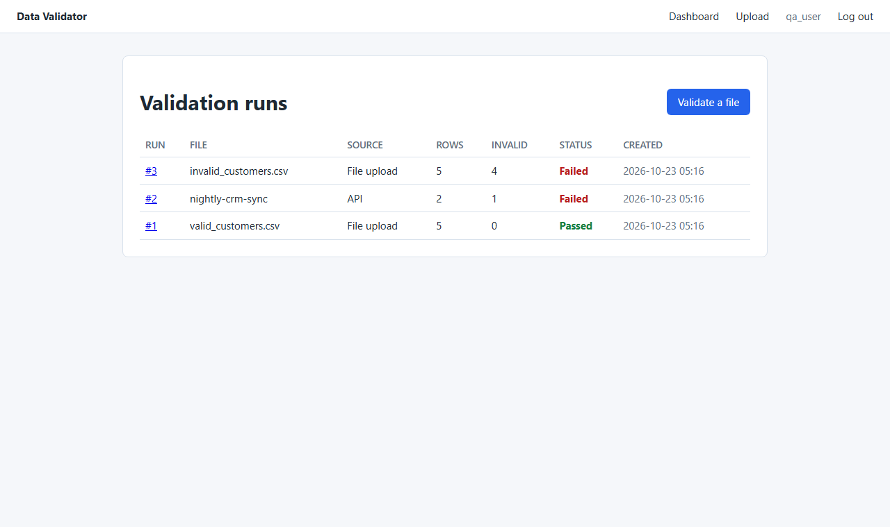
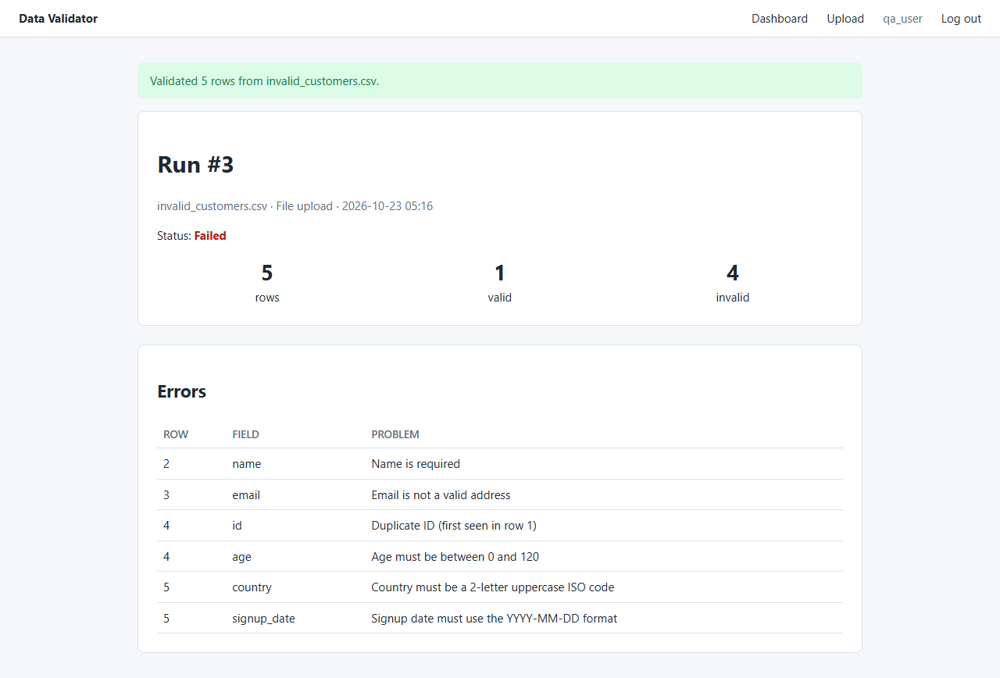
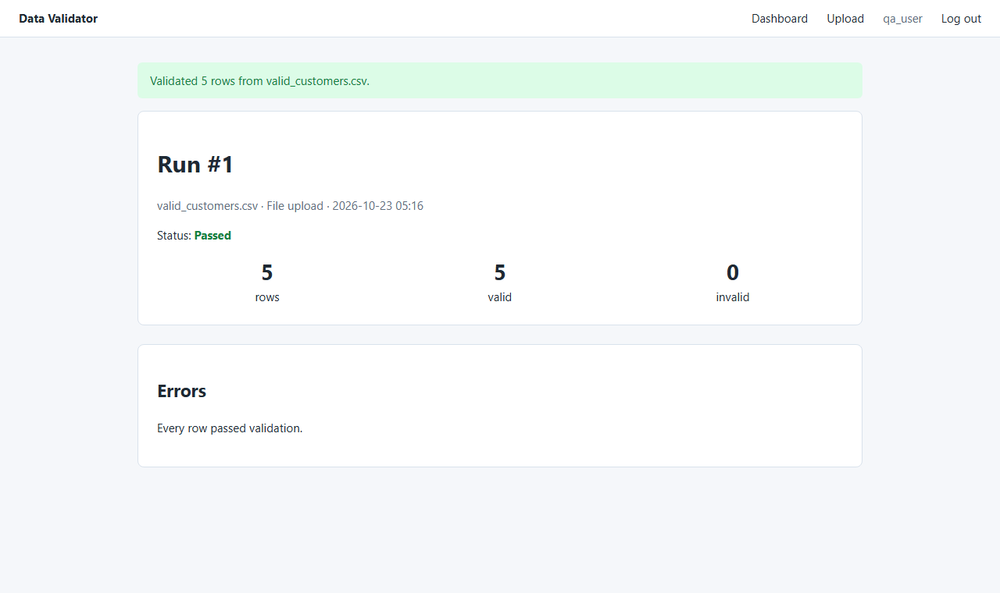
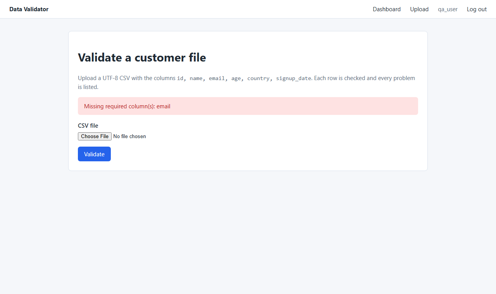
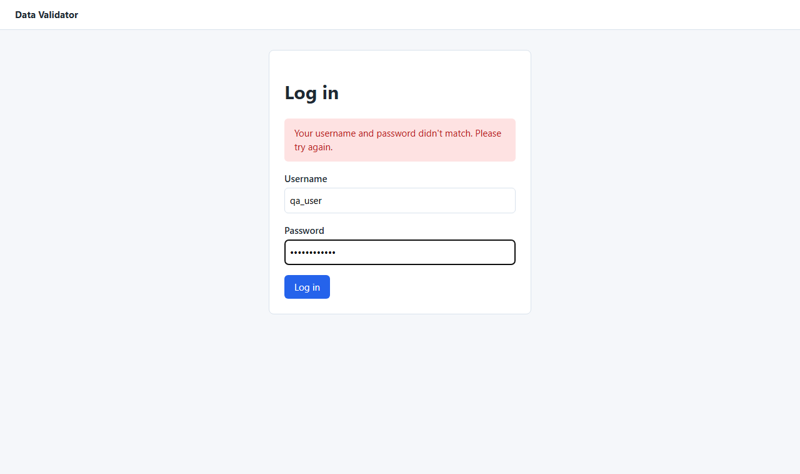
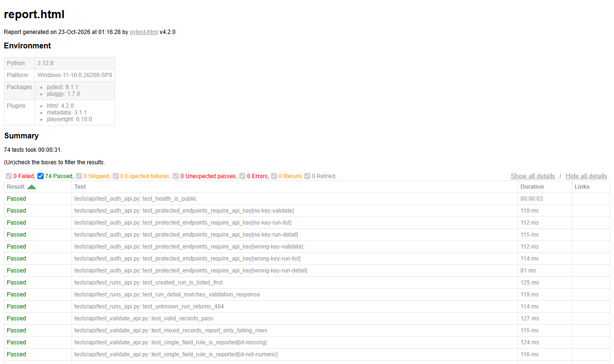

# Playwright Test Automation Framework

[](https://github.com/sahasra24/playwright-test-automation/actions/workflows/tests.yml)

A Playwright + PyTest framework built on the page-object model that automates UI and API tests for a
Django data-validation application. The suite runs in GitHub Actions on every push and publishes
HTML test reports.

## Screenshots

| Dashboard | Run with row-level errors |
|-----------|---------------------------|
|  |  |

| Passing run | Rejected upload |
|-------------|-----------------|
|  |  |

| Login | HTML test report (74 passing) |
|-------|-------------------------------|
|  |  |

## What's being tested

`app/` is a small Django app that validates customer CSV files. Users log in, upload a file, and get
a per-row error report. The same validation runs through a JSON API.

| Rule        | Check                                         |
|-------------|-----------------------------------------------|
| id          | required, positive integer, unique in the file |
| name        | required, at most 100 characters              |
| email       | required, valid address                       |
| age         | required, whole number between 0 and 120      |
| country     | required, 2-letter uppercase ISO code         |
| signup_date | required, `YYYY-MM-DD`, not in the future (UTC) |

| Endpoint                | Auth        | Purpose                                |
|-------------------------|-------------|----------------------------------------|
| `GET  /api/health/`     | none        | Liveness check                         |
| `POST /api/validate/`   | `X-API-Key` | Validate `{"records": [...], "name"?}` |
| `GET  /api/runs/`       | `X-API-Key` | Latest 50 runs                         |
| `GET  /api/runs/<id>/`  | `X-API-Key` | One run with its errors                |

## Framework layout

```
tests/
├── conftest.py          # boots Django on a free port with a throwaway DB, auth + API fixtures
├── pages/               # page objects: locators and user actions, no assertions
│   ├── base_page.py     #   shared header, nav, flash messages, expect_loaded()
│   ├── login_page.py
│   ├── dashboard_page.py
│   ├── upload_page.py
│   └── run_detail_page.py
├── clients/
│   └── validator_api.py # API client over Playwright's APIRequestContext
├── utils/records.py     # record/CSV builders + rule cases shared by UI and API tests
├── data/                # static CSV fixtures
├── ui/                  # browser tests (auto-marked `ui`)
└── api/                 # HTTP tests (auto-marked `api`)
```

Design choices:

- **Page objects hold locators and actions; tests hold assertions.** Locators use `data-testid`
  attributes and accessible labels, so styling changes don't break tests.
- **Log in once per session.** `auth_state` logs in through the real UI once and saves the storage
  state. `auth_page` gives each test a fresh logged-in browser context, with no repeated logins.
- **Shared rule cases.** `INVALID_FIELD_CASES` and `BOUNDARY_VALID_CASES` drive both the UI upload
  tests and the API tests, so every rule is checked through both layers.
- **Self-contained runs.** The session fixture migrates a temporary SQLite DB, seeds a user, starts
  `runserver` on a free port, and stops it afterwards. Set `BASE_URL` to target an existing
  deployment instead.
- **Failure diagnostics.** Failing UI tests embed a full-page screenshot in the HTML report and keep
  a Playwright trace in `reports/test-results/` (open it with `playwright show-trace`).

## Running locally

```bash
python -m venv .venv
# Windows: .venv\Scripts\activate    macOS/Linux: source .venv/bin/activate
pip install -r requirements.txt
python -m playwright install chromium

pytest                              # everything, Chromium
pytest -m api                       # API tests only (no browser needed)
pytest -m ui --browser firefox      # UI tests in Firefox
pytest -m smoke                     # critical path only
pytest -m ui --headed --slowmo 300  # watch the browser
```

The HTML report is written to `reports/report.html`, and the app's log to `reports/server.log`.

To use the app by hand:

```bash
cd app
python manage.py migrate
python manage.py seed_user --username demo --password demo-pass-123
python manage.py runserver        # http://127.0.0.1:8000, API key: dev-api-key
```

## Configuration

| Variable            | Default        | Used by                     |
|---------------------|----------------|-----------------------------|
| `BASE_URL`          | (unset)        | Tests: skip booting the app |
| `TEST_USERNAME`     | `qa_user`      | Tests                       |
| `TEST_PASSWORD`     | `qa-Passw0rd!` | Tests                       |
| `VALIDATOR_API_KEY` | `dev-api-key` (app) / `test-api-key` (tests) | Both |
| `DJANGO_DB_PATH`    | `app/db.sqlite3` | App                       |
| `DJANGO_DEBUG`      | `1`            | App                         |

## CI

`.github/workflows/tests.yml` runs on every push and pull request:

- **API tests**: one job, no browser install.
- **UI tests**: a matrix over Chromium and Firefox, with `fail-fast` off so one browser's failure
  doesn't hide the other's results.

Each job uploads its `reports/` folder (HTML report, server log, failure screenshots and traces) as a
build artifact, even when tests fail.
